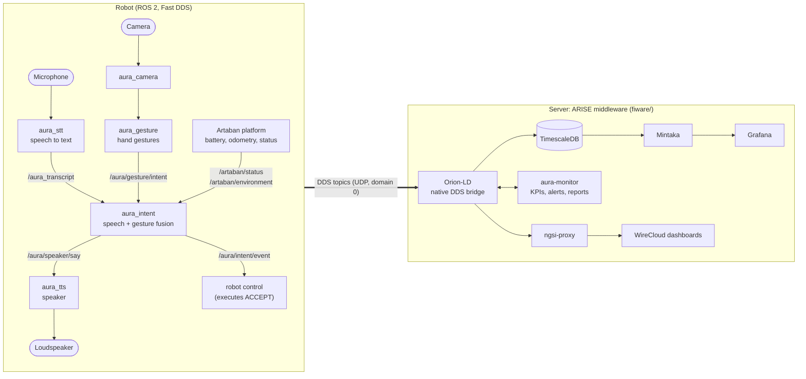

# AURA — Adaptive User-intent Recognition & Augmented interaction for industrial robots

AURA is a research and development project that makes industrial inspection robots easier and safer for non-expert operators to supervise in hazardous or contaminated environments such as oil and gas facilities, waste treatment plants, and post-disaster sites. Instead of requiring specialised training or fragile single-channel control, AURA lets an operator direct a robot naturally — by speaking to it and by using a small set of clear hand gestures — while the robot communicates back what it has understood and what it is about to do. The system recognises not only the command itself but also whether the operator is genuinely addressing the robot and how confident it is in what it heard or saw, so control stays reliable even when noise, protective equipment, or difficult site conditions would otherwise break communication down.

## Architecture

AURA is a set of ROS 2 nodes on the robot plus an optional server side (the ARISE middleware). Every box below is its
own process and talks to the others only through ROS 2 topics (Fast DDS), so each module can be started, replaced or
tested on its own.



| Package | Role | Input | Output | Model / runtime |
| --- | --- | --- | --- | --- |
| `aura_interfaces` | message definitions: `ArtabanStatus`, `EnvironmentReading`, `GestureIntent`, `IntentEvent`, `ModuleStatus` | | | |
| `aura_stt` | streaming speech to text with endpointing | microphone or a WAV file | `/aura_transcript`, `/aura_partial_transcript`, `/aura/stt/status` | fine-tuned NVIDIA Nemotron RNNT (Transformers, CPU) |
| `aura_gesture` | camera node and hand-gesture recognition with a confidence-aware k-of-n gate | camera, MJPEG URL or `/aura/camera/image_raw/compressed` | `/aura/gesture/intent`, `/aura/gesture/hypothesis`, `/aura/gesture/detections`, `/aura/gesture/status` | HaGRIDv2 YOLOv10n (ONNX Runtime) |
| `aura_intent` | turns transcripts and gestures into operator commands, asks for confirmation, publishes every decision | `/aura_transcript`, `/aura/gesture/intent`, `/artaban/status`, `/artaban/environment` | `/aura/intent/event`, `/aura/speaker/say`, `/aura/intent/status` | LFM2.5-1.2B with LoRA, GGUF (llama.cpp) |
| `aura_tts` | speaks questions and acknowledgements, newest request wins | `/aura/speaker/say` | audio, `/aura/speaker/speaking`, `/aura/speaker/status` | Supertonic 3 int8 (sherpa-onnx) |
| `fiware/` | ARISE middleware: Orion-LD with native DDS, TimescaleDB, Mintaka, Grafana, `aura-monitor`, WireCloud | the DDS topics above and the robot platform topics | NGSI-LD entities, KPIs, alerts, mission reports, dashboards | Docker Compose |

**One voice command, end to end:** the operator speaks, `aura_stt` publishes the phrase, `aura_intent` parses it
(`stop`, `pause` and `cancel` execute at once; other commands are held), asks "Did you say ...?" through `aura_tts`, and
a spoken yes or a thumb-up from `aura_gesture` confirms it. The final decision, with confidence and outcome, is
published as `IntentEvent` and mirrored to the server, where the dashboards and KPIs are built from it.

More detail: the topic contract and NGSI-LD entities are in [fiware/docs/DATA_MODEL.md](fiware/docs/DATA_MODEL.md);
how a robot connects to the broker over DDS (ports, discovery, how to run and check) is in
[fiware/docs/DDS_INTEGRATION.md](fiware/docs/DDS_INTEGRATION.md); the full-stack test tooling is in
[tools/integration/README.md](tools/integration/README.md).

## FIWARE condition monitoring (ARISE middleware)

`fiware/` runs the ARISE all-in-one middleware locally: Orion-LD with native ROS 2 / DDS bridging, TimescaleDB,
Mintaka, Grafana, the `aura-monitor` analytics service and the AURA dashboard in WireCloud. Robot and module data
arrives as ROS 2 topics (contract in `fiware/docs/DATA_MODEL.md`; robot connection over DDS in
[fiware/docs/DDS_INTEGRATION.md](fiware/docs/DDS_INTEGRATION.md)). See [fiware/README.md](fiware/README.md).

## Microphone speech-to-text (ROS2)

`src/aura_stt` is an `ament_python` package. It captures microphone input
at a supported hardware rate, downmixes to mono, and continuously resamples to
16 kHz for the local fine-tuned NVIDIA Nemotron RNNT model on the edge device's
CPU. The module supports streaming inference and NeMo-exported encoder adapters.
The fine-tuned model files are hosted on Hugging Face at [sensifai/aura](https://huggingface.co/sensifai/aura), and loading uses local files only.

| Topic | Type | Payload |
| --- | --- | --- |
| `/aura_partial_transcript` | `std_msgs/msg/String` | Cumulative hypothesis for the current phrase; replace the previous partial |
| `/aura_transcript` | `std_msgs/msg/String` | One completed phrase, after a pause or the duration limit |
| `/aura/stt/status` | `aura_interfaces/msg/ModuleStatus` | 1 Hz health: finals per minute, end-of-speech to final latency, capture level |

Build in a sourced ROS2 environment (for example ROS2 Jazzy on Ubuntu 24.04).
Use the **same Python interpreter as `rclpy` and `colcon`** for the ML packages.
Run the following commands from the project root.

```bash
source /opt/ros/jazzy/setup.bash
# PortAudio is required by sounddevice; Ubuntu:
sudo apt-get install libportaudio2 python3-colcon-common-extensions python3-venv
python3 -m venv --system-site-packages .venv
source .venv/bin/activate
python -m pip install torch --index-url https://download.pytorch.org/whl/cpu
python -m pip install -r src/aura_stt/requirements.txt
python -m pip install -r src/aura_stt/requirements-test.txt
python -c 'import rclpy, torch, transformers, sounddevice'
python -m colcon build --symlink-install --packages-select aura_stt
source install/setup.bash
```

### Download model weights

Download the fine-tuned model files from Hugging Face ([sensifai/aura](https://huggingface.co/sensifai/aura)) into `model/`:

```bash
# Using huggingface-cli
pip install huggingface_hub
huggingface-cli download sensifai/aura --local-dir model

# Or clone directly using git
git clone https://huggingface.co/sensifai/aura model
```

Run with the fine-tuned model in the project's `model/` directory:

```bash
ros2 run aura_stt stt --ros-args \
  -p model_dir:=model \
  -p device:=cpu
```

Or load all settings from the installed configuration, with `device: cpu`
set in the YAML file:

```bash
ros2 launch aura_stt stt.launch.py
ros2 launch aura_stt stt.launch.py latency_ms:=160
# Supply a configuration with paths for the ROS2 host:
ros2 launch aura_stt stt.launch.py params_file:=/absolute/path/to/stt.yaml
```

In another sourced terminal, inspect completed speech:

```bash
ros2 topic echo /aura_transcript
ros2 topic echo /aura_partial_transcript
```

The default `model_dir` is `model`, resolved relative to the working directory.
Run from the project root or set `model_dir` to the deployed model's path.
`model_dir` also accepts `nemotron-welding-real` or
`nemotron-welding-librispeech` adapter directories; preserve their relative
`base_model` directory from `adapter_config.json`, or update that pointer.
Raw `.nemo`/Lightning checkpoints and ONNX exports need conversion to the
supported Transformers format before use here.
For `ros2 run`, `AURA_STT_MODEL_DIR` supplies the default model path; explicit
ROS parameters take precedence.

The parameters in `src/aura_stt/config/stt.yaml` control both topic names,
`device` (set to `cpu` for edge deployment), `input_device` (empty for automatic
microphone discovery, or a quoted device index/name), and `latency_ms`
(80, 160, 560, or 1120).
List microphone devices using
`python -m sounddevice` in the runtime environment. For example:

```bash
ros2 run aura_stt stt --ros-args \
  -p model_dir:=/path/to/model -p input_device:="'1'" \
  -p device:=cpu -p latency_ms:=560
```

`aura_stt/config.py` provides the immutable `SttConfig` configuration module,
including defaults, latency-to-lookahead mapping and startup validation.
Configuration precedence is: built-in/environment defaults, YAML parameters,
then explicit launch/ROS overrides. The launch `latency_ms` argument is optional;
when omitted, the YAML value applies. ROS parameters are read-only after startup
because changing latency or the microphone requires rebuilding the live session.
`num_threads` controls PyTorch CPU threads (default 4). `debug_audio:=true`
logs the capture duration and peak amplitude every five seconds. Persistent
digital silence produces a diagnostic warning even when debug logging is off.

Every input device reported by PortAudio is eligible for capture, including USB,
onboard, Bluetooth, audio interfaces and system/virtual inputs. Automatic
selection prefers hardware inputs and, when enabled, USB inputs; other inputs
remain available as fallbacks. An explicit `input_device` selects an index or
an unambiguous name match. One input is selected for STT, and its capture
channels are averaged to mono. DSP runs on a worker thread.

`input_sample_rate: 0` probes supported rates, preferring 48 kHz; a positive
value requires that rate. `capture_channels: 0` tries stereo, mono, then the
full native channel count; a positive value selects that channel count. `capture_block_ms`
sets the microphone callback period (default 100 ms), independently of the
model's `latency_ms`. `input_latency: 0.0` uses the device's high-latency setting;
a positive value requests that many seconds. `prefer_usb` and `include_internal`
control automatic discovery. A stateful resampler preserves continuity across
capture blocks and feeds the STT pipeline in 20 ms blocks at 16 kHz.

For repeatable dataset debugging, set `audio_file` to a 16 kHz mono PCM16 WAV.
It plays into the same audio queue in 20 ms blocks at real time. Empty
`audio_file` selects the microphone. Replay finishes the last phrase at EOF and
leaves the node running so subscribers can inspect the result.

```bash
ros2 run aura_stt stt --ros-args -p model_dir:=/path/to/model \
  -p audio_file:=/path/to/dataset.wav -p device:=cpu -p latency_ms:=560
```

Speech starts when a 20 ms audio block exceeds `speech_threshold_db` (default
−40 dBFS). `pre_roll_s` preserves preceding audio; `silence_s` ends a phrase
after 0.8 seconds of quiet. `max_utterance_s` bounds a phrase at 20 seconds.
This energy gate needs tuning for room noise and microphone gain; it does not
distinguish speech from loud machinery. Increase the threshold to reject noise,
or lower it to capture quieter speech. Continuous speech reaching the duration
limit is split at that boundary. Finals require endpoint silence and decoding
of the padded tail, so they arrive later than streaming partials.

Capture, resampling, endpointing, and inference run outside the ROS executor;
only the executor publishes messages. Audio and utterance backlogs are bounded.
The raw microphone queue keeps the newest two seconds if its worker falls
behind. Capture xruns and dropped blocks are
reported in diagnostics. Exhausted downstream STT queues or inference errors
stop the node with an error. Ctrl+C closes capture and unblocks readers;
an incomplete phrase at shutdown may be discarded.
Grant microphone access to the application running the node when required.

Validate audio buffering and endpoints without ROS2:

```bash
PYTHONPATH=src/aura_stt python -m unittest discover -s src/aura_stt/test -p 'test_*.py' -v
```

Validate actual streaming weights with a 16 kHz mono PCM16 speech recording:

```bash
PYTHONPATH=src/aura_stt python src/aura_stt/test/smoke_model.py \
  --model-dir /path/to/model --wav /path/to/speech.wav --device cpu
```

For an installed ROS2 test, `test/ros_e2e.py` launches the executable, receives
partials and finals through DDS, verifies the model/latency parameters, and
checks clean shutdown. Supply `--params-file` to exercise the installed launch
file and YAML. `--expected-finals` verifies phrase boundaries, and optional
`--reference-text` calculates word error rate for that sample.

```bash
python src/aura_stt/test/ros_e2e.py --model-dir /path/to/model \
  --wav /path/to/dataset.wav --latency-ms 560 --report validation/replay.json
```

ROS2 installations using Ubuntu's Python environment may expose an older
`coverage` package that conflicts with recent `numba` imported by the feature
extractor. `requirements-test.txt` installs a compatible version inside the
virtual environment. The setup commands above install PyTorch from its CPU
wheel index for deployment on the edge device.

## Operator intent: speech + gesture fusion (ROS2)

`src/aura_intent` turns completed transcripts from `aura_stt` and accepted gestures from
`aura_gesture` into operator commands, asks the operator to confirm them through the speaker
and publishes every decision as `aura_interfaces/msg/IntentEvent`.

```
operator voice -> aura_stt -> /aura_transcript -> aura_intent (LFM2.5-1.2B + LoRA) -> /aura/speaker/say -> aura_tts
operator hand  -> aura_gesture -> /aura/gesture/intent ----^          \-> /aura/intent/event (robot + FIWARE)
```

Speech is parsed by **LFM2.5-1.2B-Instruct fine-tuned with LoRA** (GGUF, llama.cpp, CPU by
default). The model answers `{"intent": ..., "target": ...}`; the label is decoded over the closed
intent set and its sequence probability is the command confidence:

| Intent | Example | Handling |
| --- | --- | --- |
| `stop`, `pause` | "Stop, there's a worker ahead" | safety-critical: executes at once |
| `cancel` | "never mind" | answers "no" to a pending question, otherwise cancels at once |
| `confirm` | "yes, do it" | answers "yes" to a pending question |
| `resume`, `next_step`, `come_follow` | "follow me" | held: "Did you say come follow? Say yes or show thumb up." |
| `target_select` | "inspect valve seven" (target `valve seven`) | held as above |
| `unknown` | "open the valve" | addressed but unsupported: rejected with feedback |
| `none` | "Mike, follow the red line" | not addressed to the robot: `IGNORE`, no speech |

Decisions use the `IntentEvent` codes: confidence below `reject_threshold` (0.52) is `REJECT`
("please repeat"); `confirm_mode` `always` (default) holds every non-safety command as `CONFIRM`
until a voice yes/no or a gesture answers it (`thumb_up` = yes, `thumb_down` / `palm` = no) or
`confirm_timeout_s` passes; `uncertain` holds only commands below `accept_threshold` (0.72);
`never` executes directly. Gestures act directly too: `fist` = stop, `palm` = cancel, `point` =
select the pointed target. A confirmed command is published as `ACCEPT` with `outcome: correct`
(modality `fused` when voice was confirmed by gesture); a "no" publishes `cancel` with
`outcome: misrecognized` (aura-monitor's `operator_cancelled`).

| Topic | Type | Direction |
| --- | --- | --- |
| `/aura_transcript` | `std_msgs/String` | in: completed phrases |
| `/aura/gesture/intent` | `aura_interfaces/GestureIntent` | in: accepted gestures |
| `/artaban/status`, `/artaban/environment` | `ArtabanStatus`, `EnvironmentReading` | in: mission id, noise level |
| `/aura/intent/event` | `aura_interfaces/IntentEvent` | out: every decision (`ACCEPT` = execute) |
| `/aura/speaker/say` | `std_msgs/String` | out: question / feedback text for TTS |
| `/aura/intent/status` | `aura_interfaces/ModuleStatus` | out: rate, latency, thresholds, pending |

```bash
python -m pip install -r src/aura_intent/requirements.txt
python -m colcon build --symlink-install --packages-select aura_interfaces aura_intent
source install/setup.bash
ros2 launch aura_intent intent.launch.py                       # config/intent.yaml
ros2 launch aura_intent intent.launch.py confirm_mode:=uncertain
ros2 run aura_intent parse "robot, inspect the compressor bay"  # model only, no ROS graph
ros2 topic pub --once /aura_transcript std_msgs/msg/String "{data: 'follow me'}"
python -m pytest src/aura_intent/test                         # decision / confirmation logic
```

The model file `src/aura_intent/model/aura-intent-lfm2.5-1.2b-q8_0.gguf` (1.2 GB) is not in git;
it is installed into the package share by colcon. `n_gpu_layers: -1` offloads to the GPU with a
CUDA / Metal build of llama-cpp-python.

### Fine-tuning the intent model

`src/aura_intent/training/` reproduces the model on Apple silicon with MLX (LoRA rank 16 on all
16 LFM2 blocks, loss on the answer only):

```bash
cd src/aura_intent/training
uv venv --python 3.12 .venv && uv pip install --python .venv/bin/python \
  mlx-lm "transformers>=4.57" "huggingface_hub<1.0" gguf sentencepiece safetensors numpy torch \
  "llama-cpp-python>=0.3.16" pytest
.venv/bin/python generate_data.py          # data/train.jsonl, data/valid.jsonl
.venv/bin/python train.py --budget 0.7     # Metal memory and CPU threads capped at 70 %
./export_gguf.sh                           # merge LoRA into the HF weights -> ../model/*.gguf (q8_0)
.venv/bin/python evaluate.py ../model/aura-intent-lfm2.5-1.2b-q8_0.gguf
```

`generate_data.py` synthesises ASR-style transcripts (casing/punctuation variants, fillers, wake
words, recognition errors, commands followed by a reason) and side talk that must be ignored
(people addressed by name, plans, reported speech). `evaluate.py` scores a separate hand-written
set with phrasing the generator does not produce.

Current model (3,772 training transcripts, 700 iterations, peak 9.3 GiB on an M4 Pro): 94.6 % on the
74-sentence held-out set (side talk 12/12); every miss scored below the 0.72 accept threshold, so
nothing executes unconfirmed (precision 1.0 at >= 0.72); 64 ms p50 / 120 ms p95 per transcript on
4 CPU threads. `test/ros_e2e.py` drives both operator flows against a running node.

## Speaker: text-to-speech (ROS2)

`src/aura_tts` is the robot's voice. It speaks the confirmation questions and acknowledgements
that `aura_intent` publishes on `/aura/speaker/say`, on the edge CPU, through the default (or a
named) audio output. The model is **Supertonic 3 int8** on the sherpa-onnx runtime, chosen in an
A/B against Piper and Kokoro-82M for intelligibility in plant noise, latency and licensing. It is bundled in
`src/aura_tts/model/supertonic-3-int8` (139 MB; MIT code, OpenRAIL-M weights), stored with Git
LFS (`git lfs install && git lfs pull` after cloning), and installed into the package share by colcon.

```
aura_intent -> /aura/speaker/say -> aura_tts: normalise -> cache / Supertonic 3 -> loudspeaker
                                             \-> /aura/speaker/speaking (Bool, for STT echo gating)
```

- **Newest request wins:** a new message interrupts the one playing within one audio block, so
  "Stop, executing." never waits behind a long report.
- **Phrase cache:** the fixed prompts of `aura_intent` (`cache_phrases`) are synthesised at start-up
  and play with no synthesis delay (about 10 ms from message to audio).
- **Sentence streaming:** the first sentence plays while the next is synthesised.
- **Text normalisation:** equipment tags are spelled letter by letter and digit by digit
  (`V-104` → "vee one zero four"), and units, numbers and times are written out (`84 °C`,
  `20 %LEL`, `14:30`). Without it every model misread tags; with it, both STT models hear 95 % of
  tag and value tokens correctly instead of 60 %.

| Topic | Type | Direction |
| --- | --- | --- |
| `/aura/speaker/say` | `std_msgs/String` | in: text to speak |
| `/aura/speaker/speaking` | `std_msgs/Bool` (transient local) | out: true while audio plays |
| `/aura/speaker/status` | `aura_interfaces/ModuleStatus` | out: rate, first-audio and synthesis latency, interruptions |

```bash
sudo apt-get install libportaudio2
python -m pip install -r src/aura_tts/requirements.txt
python -m colcon build --symlink-install --packages-select aura_tts
source install/setup.bash
ros2 launch aura_tts tts.launch.py                          # config/tts.yaml, default audio output
ros2 launch aura_tts tts.launch.py output_device:=none      # headless (VM / CI): timing without sound
ros2 launch aura_tts tts.launch.py voice:=3 output_device:=USB
ros2 topic pub --once /aura/speaker/say std_msgs/msg/String "{data: 'Thermal reading on motor M-12 is 84 °C.'}"
python -m pytest src/aura_tts/test --ignore=src/aura_tts/test/ros_e2e.py
python3 src/aura_tts/test/ros_e2e.py                        # against a running node
```

`model_dir` can point to any sherpa-onnx Supertonic, Kokoro or Piper/VITS directory; the family
is detected from its files (Piper/VITS needs sherpa-onnx 1.13.x, which still includes espeak-ng).
On ROS 2 Lyrical in the arm64 VM, synthesised prompts start speaking 290–750 ms after the
message (p50 390 ms) and cached ones after 10 ms. The A/B harness is in `tools/tts_ab/`.

## Camera hand-gesture recognition (ROS2)

`src/aura_gesture` is an `ament_python` package; `src/aura_interfaces` holds its
stable message, `aura_interfaces/msg/GestureIntent`. A camera node publishes
JPEG frames; the gesture node runs the bundled HaGRIDv2 YOLOv10n detector
(`src/aura_gesture/model/gesture/YOLOv10n_gestures.onnx`, 9.3 MB) with ONNX
Runtime and turns per-frame predictions into operator intents through a
confidence-aware k-of-n gate. The model was selected in an A/B study of candidate detectors.

| Gesture (proposal) | Canonical | Default intent |
| --- | --- | --- |
| thumb up | `thumb_up` | `confirm` |
| thumb down | `thumb_down` | `reject` |
| fist raise | `fist` | `stop` (faster: threshold 0.7, 3 votes) |
| open palm | `palm` | `cancel` |
| point finger | `point` | `select` |

| Topic | Type | Payload |
| --- | --- | --- |
| `/aura/camera/image_raw/compressed` | `sensor_msgs/CompressedImage` | Camera frames (JPEG) |
| `/aura/gesture/hypothesis` | `aura_interfaces/GestureIntent` | Every processed frame: best gesture, frame and window confidence, votes, state |
| `/aura/gesture/intent` | `aura_interfaces/GestureIntent` | Accepted intents only, once per held gesture |
| `/aura/gesture/detections` | `vision_msgs/Detection2DArray` | All hands with raw class and score |
| `/aura/gesture/debug_image/compressed` | `sensor_msgs/CompressedImage` | Annotated frames when `publish_debug_image: true` |
| `/aura/gesture/status` | `aura_interfaces/ModuleStatus` | 1 Hz health: fps, latency p50, dropped / stale frames |
| `/diagnostics` | `diagnostic_msgs/DiagnosticArray` | fps, inference/latency p50/p95, dropped/stale frames, accepted count |

Build in the same sourced environment as `aura_stt` (ROS2 Jazzy or Lyrical):

```bash
source /opt/ros/lyrical/setup.bash
sudo apt-get install ros-lyrical-vision-msgs ros-lyrical-cv-bridge python3-opencv build-essential
python3 -m venv --system-site-packages .venv && source .venv/bin/activate
python -m pip install -r src/aura_gesture/requirements.txt
python -m colcon build --symlink-install --packages-select aura_interfaces aura_gesture
source install/setup.bash
```

Run with a local camera (`source` is a device index, a V4L2 path or an MJPEG URL):

```bash
ros2 launch aura_gesture gesture.launch.py source:=/dev/video0
ros2 launch aura_gesture gesture.launch.py source:=/dev/video0 debug:=true   # annotated stream
ros2 topic echo /aura/gesture/intent
```

`config/gesture.yaml` holds every parameter. Relative `model_path` values are
tried against the working directory first and then the installed package
share, so the bundled model works from any directory. `providers` selects ONNX
Runtime execution providers (empty = TensorRT, then CUDA, then CPU when
available). A gesture is accepted when `votes` of the last `window` frames
reach its `thresholds` entry; the same gesture re-arms only after it has been
absent for `rearm_frames` frames, and `cooldown_s` separates consecutive
intents. Frames older than `max_frame_age_s` are dropped instead of queued, so
decisions never lag the operator. Parameters are read-only after startup.

### Camera from a Mac host into a Linux VM

OrbStack/Docker VMs cannot open the Mac camera. Stream it as MJPEG on the Mac
(bound to 127.0.0.1) and point the camera node at `host.orb.internal`:

```bash
# Mac (needs opencv-python; grant Camera access to the terminal app)
python src/aura_gesture/tools/mac_camera_stream.py
# VM
ros2 launch aura_gesture gesture.launch.py source:=http://host.orb.internal:18090/stream.mjpg
```

`--guided --distances 1,2,3 --examples <dir>` runs the scripted test protocol:
it prompts each gesture (with a reference picture) at each operator distance
and tags every frame with the prompted label, which the camera node republishes
on `/aura/camera/annotation` for scoring.

### Debugging and data collection

```bash
ros2 run aura_gesture debug monitor                         # live terminal view
ros2 run aura_gesture debug record -o runs/t1 --label like --note "2 m, gloves" --images
ros2 run aura_gesture debug summarize runs/t1/hypotheses.jsonl --plot runs/t1/conf.png
ros2 run aura_gesture debug sweep runs/t1/hypotheses.jsonl --thresholds 0.6 0.7 0.8 0.9 --votes 3 5
ros2 run aura_gesture debug snapshot -o runs/snaps --count 5
```

`record` stores every per-frame hypothesis (raw label, frame and window
confidence, votes, state, latency), intents, diagnostics and ground-truth
annotations as JSONL. With `--images` it also saves annotated frames for
accepted intents, gesture changes, disagreements with the ground truth and
every Nth frame, and writes `gallery.html` to review them. `sweep` replays the
recorded scores through the same acceptance gate to tune thresholds without
re-recording. Use `--prefix /aura/gesture_a` for A/B launch arms.

### Tests

```bash
python -m pytest src/aura_gesture/test --ignore=src/aura_gesture/test/ros_e2e.py
# live A/B on one camera (two gesture nodes, same frames) + bag recording
python src/aura_gesture/test/ros_e2e.py live --models model/gesture/YOLOv10n_gestures.onnx \
  --bag runs/live1 --report runs/live1.json
# replay A/B: each model sees the identical recorded frames at 1x
python src/aura_gesture/test/ros_e2e.py replay --bag runs/live1 \
  --models model/gesture/YOLOv10n_gestures.onnx model/gesture/YOLOv10x_gestures.onnx --report runs/replay1.json
```

`ros_e2e.py` scores against the guided-stream ground truth: command success per
gesture and per distance, wrong intents, false activations per minute during
"no gesture", time to accept, stop response, frame accuracy and confidence,
capture-to-intent latency, and clean shutdown. The 116 MB YOLOv10x comparison
model is not bundled; export it with the research tooling into `model/gesture/`.
